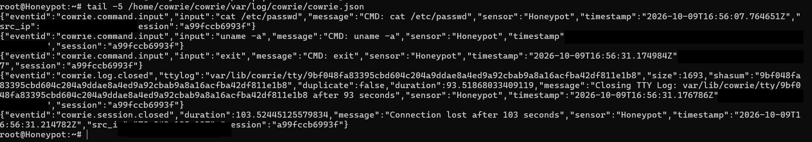
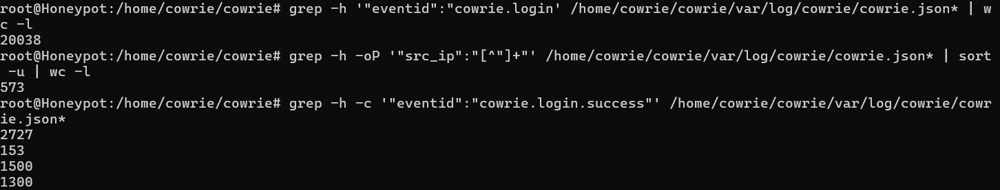
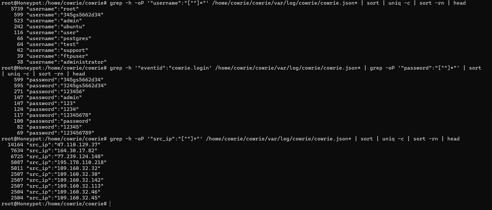
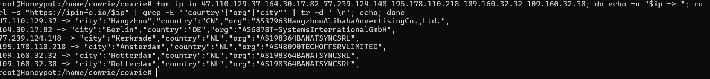
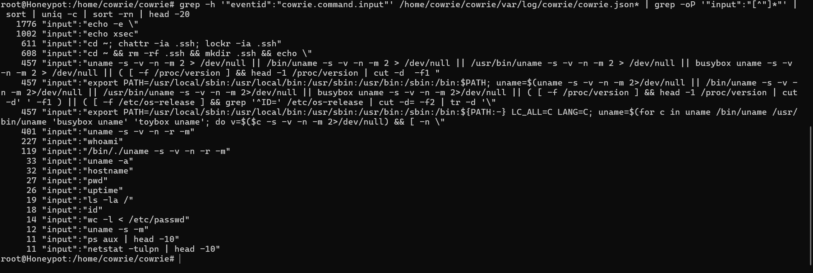

# Phase 4 - Honeypot (Cowrie)

## Objectif
Exposer un leurre SSH sur Internet pour capturer et analyser les
attaques automatisées réelles.

## Infrastructure
- VPS Hetzner Cloud (CAX11, Ubuntu 22.04, Nuremberg)
- Cowrie v2.5.0 installé sous un utilisateur non-privilegie (securite)
- Cowrie écoute sur le port 2222
- SSH d'administration déplacé sur le port 2244
- Redirection iptables : port 22 (public) -> 2222 (Cowrie)

## Fonctionnement
Cowrie imite un serveur SSH vulnérable (faux Debian). Les attaquants
qui "entrent" évoluent dans un faux système isolé pendant que chaque
action est enregistrée (connexions, identifiants testés, commandes,
fichiers téléchargés).

## Données collectées
- Logs texte et JSON structuré (var/log/cowrie/)
- Enregistrement TTY rejouable de chaque session
- Pour chaque événement : IP source, horodatage, identifiants, commandes

## Test de validation
Connexion depuis mon poste sur le port 22 -> redirigée vers Cowrie.
Faux shell obtenu, commandes enregistrées 




## Analyse des attaques (3,5 jours de collecte)

Du 9 au 12 octobre 2026, sans aucune publicité, le honeypot a encaissé plus de 20 000 tentatives d'intrusion venues de 573 adresses du monde entier.

Toutes les commandes ci-dessous sont lancées depuis le dossier des logs :

```bash
cd /home/cowrie/cowrie/var/log/cowrie
```

### Chiffres clés

```bash
# Tentatives de connexion
grep -h '"eventid":"cowrie.login' cowrie.json* | wc -l
# IP uniques
grep -h -oP '"src_ip":"[^"]+"' cowrie.json* | sort -u | wc -l
# Connexions réussies
grep -h -c '"eventid":"cowrie.login.success"' cowrie.json*
```

| Métrique | Valeur |
|---|---|
| Tentatives de connexion | 20 038 |
| IP attaquantes uniques | 573 |
| Connexions réussies (dans le leurre) | 5 680 |
| Durée de collecte | ~3,5 jours |



### Identifiants testés (logins, mots de passe, IP)

```bash
grep -h -oP '"username":"[^"]*"' cowrie.json* | sort | uniq -c | sort -rn | head
grep -h '"eventid":"cowrie.login' cowrie.json* | grep -oP '"password":"[^"]*"' | sort | uniq -c | sort -rn | head
grep -h -oP '"src_ip":"[^"]+"' cowrie.json* | sort | uniq -c | sort -rn | head
```

**Top 10 des noms d'utilisateur**

| Utilisateur | Tentatives |
|---|---|
| root | 5 739 |
| 345gs5662d34 | 599 |
| admin | 523 |
| ubuntu | 242 |
| user | 116 |
| postgres | 66 |
| test | 64 |
| support | 42 |
| ftpuser | 39 |
| administrator | 38 |

**Top 10 des mots de passe**

| Mot de passe | Tentatives |
|---|---|
| 345gs5662d34 | 599 |
| 3245gs5662d34 | 595 |
| 123456 | 271 |
| admin | 147 |
| 123 | 147 |
| 1234 | 124 |
| 12345678 | 117 |
| password | 100 |
| 12345 | 82 |
| 123456789 | 69 |

**Top 10 des IP les plus agressives**

| IP | Tentatives |
|---|---|
| 47.110.129.37 | 14 164 |
| 164.30.17.82 | 7 634 |
| 77.239.124.148 | 6 725 |
| 195.178.110.218 | 5 087 |
| 109.160.32.32 | 5 011 |
| 109.160.32.30 | 2 507 |
| 109.160.32.142 | 2 507 |
| 109.160.32.113 | 2 507 |
| 109.160.32.46 | 2 504 |
| 109.160.32.45 | 2 504 |



Le compte `root` écrase tout : c'est l'administrateur, celui qui donne les pleins pouvoirs si on le casse. Côté mots de passe, les deux premiers (`345gs5662d34`) sont des mots de passe par défaut d'objets connectés (IoT), le reste c'est le classique : `123456`, `admin`, `password`.

### D'où viennent les attaquants

```bash
for ip in 47.110.129.37 164.30.17.82 77.239.124.148 195.178.110.218 109.160.32.32 109.160.32.30; do
  echo -n "$ip -> "; curl -s "https://ipinfo.io/$ip" | grep -E '"country"|"org"|"city"' | tr -d ' \n'; echo
done
```

| IP | Ville | Pays | Organisation |
|---|---|---|---|
| 47.110.129.37 | Hangzhou | CN | AS37963 Alibaba |
| 164.30.17.82 | Berlin | DE | AS6878 T-Systems |
| 77.239.124.148 | Kerkrade | NL | AS198364 BANATSYNCSRL |
| 195.178.110.218 | Amsterdam | NL | AS48090 TECHOFFS |
| 109.160.32.32 | Rotterdam | NL | AS198364 BANATSYNCSRL |
| 109.160.32.30 | Rotterdam | NL | AS198364 BANATSYNCSRL |



Une seule IP chinoise (Alibaba Cloud) pèse à elle seule 14 000 tentatives, l'attaquant le plus acharné. Et surtout, tout le bloc `109.160.32.x` est hébergé chez le même opérateur néerlandais, **AS198364 BANATSYNCSRL**, un hébergeur complaisant type "bulletproof hosting". Plusieurs IP voisines qui frappent en parallèle avec le même comportement : c'est un botnet coordonné.

### Ce que les bots font une fois "entrés"

```bash
grep -h '"eventid":"cowrie.command.input"' cowrie.json* | grep -oP '"input":"[^"]*"' | sort | uniq -c | sort -rn | head -20
```

Les commandes capturées révèlent un mode opératoire type botnet (famille Mirai / Mozi), en trois étapes :

1. **Tester le shell** (~2 780 fois) : `echo xsec`, `echo -e`. Ils vérifient qu'ils ont bien un accès fonctionnel avant d'agir.
2. **Reconnaissance du système** (~2 300 fois) : `uname -s -v -n -m`, `whoami`, `id`, `ps aux`, `netstat`. Les variantes `busybox uname` cherchent l'architecture CPU (x86 / ARM / MIPS) pour télécharger ensuite le bon binaire malveillant.
3. **Persistance par clé SSH** (~1 220 fois) : `chattr -ia .ssh`, puis `rm -rf .ssh && mkdir .ssh && echo <leur_clé_publique>`. Ils effacent les clés existantes et installent la leur pour garder un accès permanent, même si le mot de passe change ensuite.



### Ce que j'en retiens

- **Internet est scanné en permanence.** Un serveur neuf se fait attaquer en quelques minutes, sans jamais avoir été annoncé.
- **Les mots de passe faibles tombent en premier.** Imposer des mots de passe forts coupe la majorité des attaques.
- **Désactiver l'authentification SSH par mot de passe** (clés uniquement) rend tout ce brute-force inutile.
- **Surveiller `authorized_keys`** : sa modification est un signal d'intrusion fort, c'est la technique de persistance n°1 observée ici.
- **Bloquer les plages d'IP abusives** (ici AS198364) et laisser fail2ban gérer le reste.
